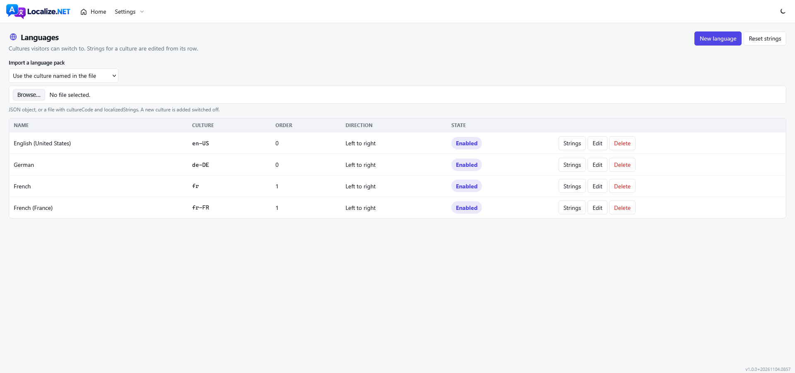
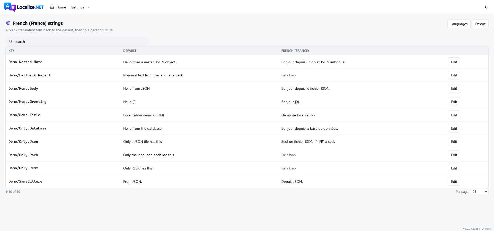
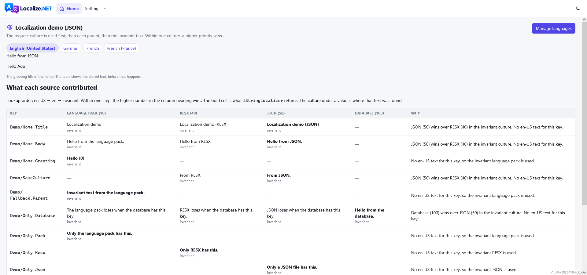
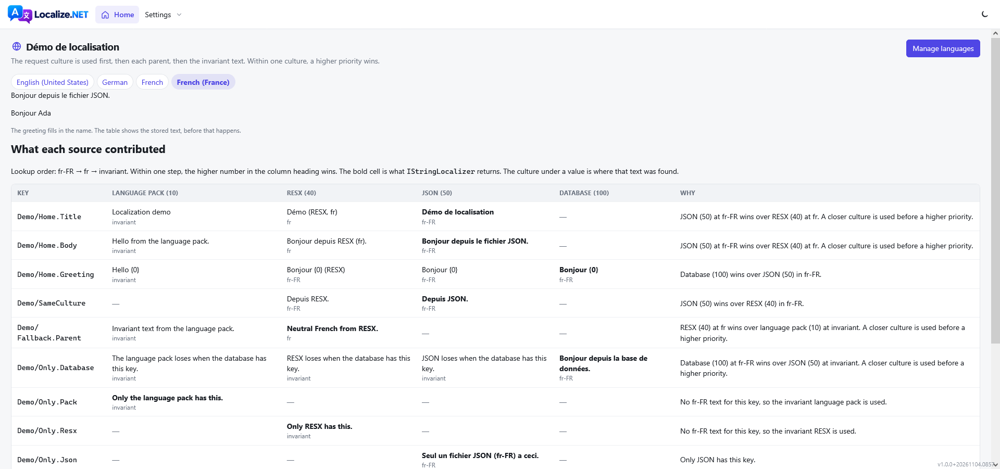

Database, JSON, and RESX translations behind one `IStringLocalizer`, with a Blazor admin built on NetForge.

A string is resolved from the request culture, then each parent culture, then the invariant text. Within one culture the sources are merged by priority. A higher number wins:

| Source | Priority | Writes |
|---|---|---|
| Language packs (`ILanguagePack`) | 10 | No |
| RESX | 40 | No |
| JSON files | 50 | No |
| Database | 100 | Yes, from the admin |

RESX, JSON, and language packs are read-only. The admin manages database rows only. Registering a database leaves the other sources in place. They keep supplying a string until a row exists for that key and culture.

A row is written when someone saves in the editor, imports a file, or resets the scope to its language packs. `TrackMissingKeys` also writes one, for a key that no source had, and stores the key itself as the invariant text. Once that row exists, the stored text is what the localizer returns. Editing the RESX or JSON file has no effect on that key. Delete the row and the file is used again.

Set `Localize:JsonOverridesDatabase` when a deployed file should beat a stored row.

The invariant culture is stored as an empty culture code. A missing translation falls through.

## Screenshots









## Add it to a site

The localizer and the admin are separate packages. A class library or another Razor class library references `Localize.Core` when it ships an `ILanguagePack` or a display-name attribute, and injects `IStringLocalizer` from `Microsoft.Extensions.Localization`. It does not reference `Localize.Components`. The host registers the pack and is the only project that takes the admin.

```csharp
builder.Services.AddSingleton<ILanguagePack, OtherLibrary.LanguagePackInvariant>();

builder.Services.AddLocalize(options =>
{
    options.JsonDirectory = "Localization";
    options.TrackMissingKeys = true; // store a key the first time a page asks for it
});
builder.Services.AddLocalizeSqlite(); // or AddLocalizeSqlServer / AddLocalizeNpgsql / AddLocalizeMySql
```

`AddLocalize` replaces `IStringLocalizer`. Call it and the database method in either order. JSON, RESX, and language packs still resolve when no database is registered. `ILanguageService` and the editor need one. Migrations run on startup (`AutoMigrate`) and, for the global scope, `DefaultCulture` (en-US) is inserted as an enabled language.

Inside a library:

```csharp
public sealed class HomePage(IStringLocalizer<HomePage> text)
{
    public string Title => text["Home.Title"];
}
```

## Admin

Reference `Localize.Components` from the host only.

```csharp
builder.Services.AddLocalizeComponents();
```

```csharp
app.UseLocalize();
app.MapLocalize();   // culture cookie and JSON export

app.MapRazorComponents<App>()
    .AddInteractiveServerRenderMode()
    .AddAdditionalAssemblies(typeof(Localize.Components.Pages.Languages).Assembly);
```

Point `ForgeRouter.AdditionalAssemblies` at the same assembly. Drop the link in with `AddLocalize()` on a menu group, or `IncludeRegistered()`, which files it under Settings.

Routes:

- `/localize/languages`
- `/localize/strings/{cultureCode}`

## Multi-tenant scope

`Language`, `LocalizableString`, and `LocalizableProperty` are partitioned by a string scope. A single-tenant site leaves it empty.

```csharp
builder.Services.AddLocalize<TenantLocalizationScope>(options => options.TrackMissingKeys = true);

public sealed class TenantLocalizationScope(IWorkContext work) : ILocalizationScope
{
    public string? GetScopeId() => work.CurrentTenant?.Id.ToString();
}
```

Call `ILanguageService.EnsureDefaultAsync()` when a tenant is created. The startup seed only covers the global scope.

## Language packs

`CultureCode` null is the invariant pack.

```csharp
public sealed class MyLanguagePack : ILanguagePack
{
    public string? CultureCode => null;

    public IDictionary<string, string> LocalizedStrings { get; } = new Dictionary<string, string>
    {
        ["App/Home.Title"] = "Home",
    };
}
```

`T["App/Home.Title"]` reads that text until an editor, a JSON file, or a RESX overrides it. `T["App/Home.Greeting", name]` formats with the current UI culture. The string editor lists every key those sources know, and saving writes a database override for the current scope. Reset on the languages page deletes the scope's stored strings and inserts the packs again. The files stay on disk, but the new rows win over RESX and JSON for those keys.

## JSON

`Localize:JsonDirectory` is relative to the content root.

- `Localization/fr-FR.json` or `Localization/fr-FR/Home.json` is French. Nested objects flatten with dots (`Home.Title`).
- `default.json` or `invariant.json` is the invariant culture.
- A file named `Home.json` in the root of that folder is ignored, so a stray JSON file is not treated as a culture.
- The admin import accepts a flat dictionary, nested objects, or `{ "cultureCode", "localizedStrings" }`. A culture the file introduces is added switched off.

## RESX

```csharp
builder.Services.AddLocalizeResx<SharedResources>();
```

The type needs the generated public static `ResourceManager`. RESX is read-only. Parent cultures are not applied twice; the catalog walks them.

## Entity fields

UI strings and translated entity fields are different tables. The entity keeps the invariant value. A row in `LocalizableProperties` replaces one property for one culture.

```csharp
string? title = await properties.ValueOrDefaultAsync(
    cultureCode, typeof(Page).FullName!, page.Id.ToString(), "Title", page.Title);
```

`FindAsync` loads a batch. `DeleteForEntityAsync` removes every culture when the entity is deleted. Scope is included, so two tenants with the same entity id do not collide.

`LocalizedDisplayNameAttribute` and `LocalizedHelpTextAttribute` take a catalog key. They resolve `IStringLocalizer` once the host has started.

## Options

Bound from the `Localize` section.

| Option | Default | |
|---|---|---|
| `DefaultCulture` | `en-US` | Used when the visitor has not chosen, and seeded as a language |
| `CultureCookieName` | `CurrentCulture` | |
| `UseParentCultureFallback` | true | `fr-FR` then `fr` then invariant |
| `TrackMissingKeys` | false | Store a missing key the first time a page asks for it. That row then wins over a file added later |
| `JsonDirectory` | empty | No JSON until this is set |
| `JsonOverridesDatabase` | false | |
| `AutoMigrate` | true | |
| `SeedDefaultLanguage` | true | Global scope only |
| `RequireAuthentication` | true | Admin pages. The culture switch stays public |
| `ManagePolicy` | empty | Authorization policy for the admin pages. Empty allows any signed-in user when authentication is required |
| `ImportOnlyKnownKeys` | false | When true, import will not create keys that have no invariant row |

## Layout

`Localize.Core` has no database and no UI. Packs and scopes reference that. `Localize.Services` is the catalog and the localizer. `Localize.Data` holds the mappings. `Localize.Data.Sql`, `.Npgsql`, `.MySql`, and `.Sqlite` hold the provider, the migrations, and the `AddLocalize*` method. Repositories are bound to `ILocalizeDbContextFactory` so they do not take over the host's `IDbContextFactory`. `Localize.Components` is the Razor class library. `Localize.Demo` is a small host that shows the switcher and the admin.
